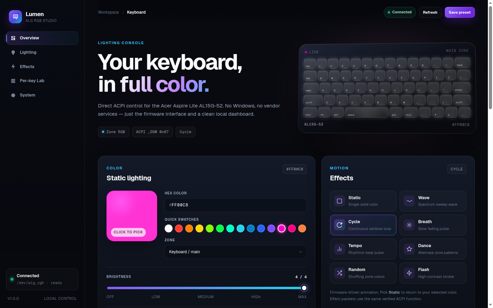
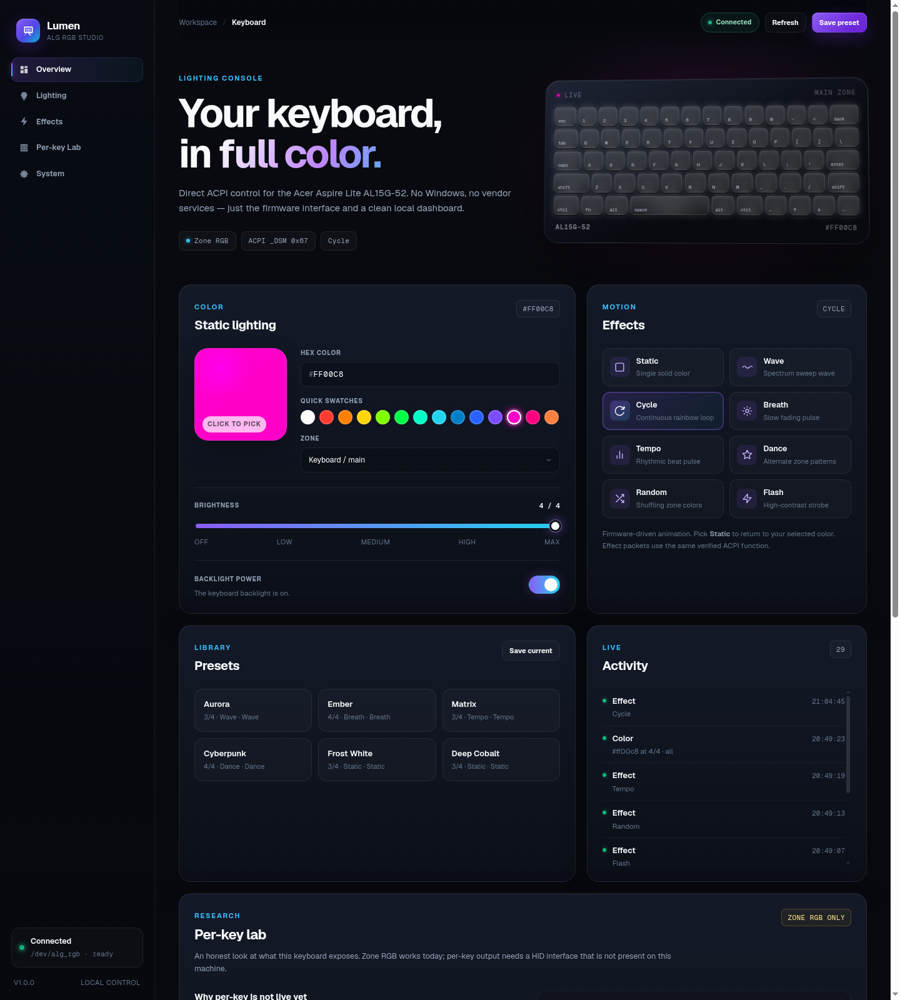

<div align="center">

# ✦ Luma ALG RGB

**Native Linux ACPI Lighting Driver & Interactive 3D Studio for Acer Aspire Lite AL15G-52**

[](https://github.com/chiragkoyande/luma-alg_rgb)
[](https://github.com/chiragkoyande/luma-alg_rgb)
[](https://github.com/chiragkoyande/luma-alg_rgb)
[](https://github.com/chiragkoyande/luma-alg_rgb)
[](https://github.com/chiragkoyande/luma-alg_rgb)
[](LICENSE)

<br>



*Real-time 3D tilted hardware keyboard console with reactive underglow, multi-zone control, and firmware motion effects.*

</div>

---

## 💻 Supported Laptop Models

| Model | Compatibility | Verification Status | Interface |
|:---|:---:|:---:|:---|
| **Acer Aspire Lite AL15G-52** | **100% Native** | **Verified & Fully Tested** | ACPI `CLV0001:00` (`\_SB.DCHU`) |
| **Acer Aspire Lite (CLV0001 Series)** | Compatible | Verified via ACPI | ACPI `CLV0001:00` (`\_SB.DCHU`) |

### Verify Your Laptop Hardware
You can verify compatibility immediately in your Linux terminal:

```bash
# 1. Check your laptop model
cat /sys/class/dmi/id/product_name
# Expected: Aspire Lite AL15G-52

# 2. Check for the Acer ACPI keyboard device node
ls -d /sys/bus/acpi/devices/CLV0001:00
# Expected: /sys/bus/acpi/devices/CLV0001:00
```

---

## 🌟 Key Highlights

- **🕹️ True 3D Hardware Visualizer**: A 3D-perspective tilted keyboard deck that reacts dynamically to your selected color, brightness, and motion presets with realistic keycap underglow.
- **⚡ Native Linux Kernel Driver**: DKMS misc character driver exposing `/dev/alg_rgb` with clean udev permissions (`uaccess` for active user seats).
- **🌊 Dynamic Multi-Zone Motion Engine**: Multi-zone phase-shifted animations sweeping across the Main keyboard, Middle, Right, Light Bar, and Logo zones (`Wave`, `Cycle`, `Breath`, `Tempo`, `Dance`, `Random`, `Flash`).
- **🎛️ Triple Interface Architecture**:
  - **SaaS Web Studio**: High-contrast, clean dark console running locally at `http://127.0.0.1:8722/`.
  - **Unix CLI**: Fast, scriptable `alg-rgb` binary with JSON export support.
  - **GNOME Shell Extension**: Quick panel indicator with 16 color swatches, brightness controls, and effects menu.
- **🛡️ Hardware Safety Protocol**: Exclusively addresses verified ACPI `_DSM 0x67` functions. Dangerous undocumented functions (`0x68–0x6A`) that cause firmware controller lockups are strictly quarantined.
- **🚀 Zero Vendor Bloat**: No Wine, no Mono, no proprietary Acer background services, and zero telemetry.

---

## 📸 Screenshots

<div align="center">

### Complete Dashboard Studio


*Full control suite featuring color pickers, quick swatches, brightness slider, motion effects, and hardware diagnostics.*

</div>

---

## 🏛️ System Architecture

```
┌─────────────────────────────────────────────────────────────┐
│                       USER INTERFACES                       │
│  ┌───────────────────┐  ┌────────────────┐  ┌────────────┐  │
│  │ Local Web Studio  │  │ GNOME Top Bar  │  │  Unix CLI  │  │
│  │ (127.0.0.1:8722)  │  │   Extension    │  │ (alg-rgb)  │  │
│  └─────────┬─────────┘  └───────┬────────┘  └─────┬──────┘  │
└────────────┼────────────────────┼─────────────────┼─────────┘
             │                    │                 │
             └───────────────┬────┴─────────────────┘
                             ▼
┌─────────────────────────────────────────────────────────────┐
│                    alg-rgb CORE CLI / API                   │
│       - Color parsing & hex normalization (#RRGGBB)         │
│       - Multi-zone animation engine with fallback           │
│       - State persistence (~/.config/alg-rgb/state)         │
└────────────────────────────┬────────────────────────────────┘
                             ▼
┌─────────────────────────────────────────────────────────────┐
│                  LINUX KERNEL /dev/alg_rgb                  │
│       - alg_rgb.ko (DKMS character driver)                  │
│       - RGB -> GRB byte order translation                   │
│       - Seat ACL permissions via udev rules                 │
└────────────────────────────┬────────────────────────────────┘
                             ▼
┌─────────────────────────────────────────────────────────────┐
│                     ACPI FIRMWARE LAYER                     │
│  Device: CLV0001:00  |  Method: \_SB.DCHU._DSM (UUID 93f2)  │
│  Function: 0x67      |  Payload: [Green, Red, Blue, Zone]   │
└────────────────────────────┬────────────────────────────────┘
                             ▼
┌─────────────────────────────────────────────────────────────┐
│                 AL15G-52 EMBEDDED CONTROLLER                │
│  [Zone 0xF0] Main Keypad  |  [Zone 0xF1] Middle Section     │
│  [Zone 0xF2] Right Side   |  [Zone 0xF3] Front Light Bar    │
│  [Zone 0xF6] Logo LED                                       │
└─────────────────────────────────────────────────────────────┘
```

---

## 🚀 Installation

### Prerequisites
Make sure your system has kernel development headers and build essentials:

```bash
# Fedora / RHEL
sudo dnf install kernel-devel-$(uname -r) dkms gcc make python3-flask

# Ubuntu / Debian
sudo apt install linux-headers-$(uname -r) dkms build-essential python3-flask

# Arch Linux
sudo pacman -S linux-headers dkms base-devel python-flask
```

### Quick Install
Clone the repository and run the idempotent installer script:

```bash
git clone https://github.com/chiragkoyande/luma-alg_rgb.git
cd luma-alg_rgb
sudo bash ./install.sh
```

The installer automatically:
1. Builds and installs `/usr/local/bin/alg-rgb`.
2. Registers and builds the `alg_rgb` DKMS kernel module.
3. Sets up `/etc/udev/rules.d/70-alg-rgb.rules` with user seat ACLs.
4. Configures systemd restore and sleep/resume hooks.
5. Deploys the local web studio and starts `alg-rgb-web.service`.
6. Installs the GNOME Shell extension.

### Add User Permissions
To ensure access across all shells and processes, add your user to the `alg-rgb` group:

```bash
sudo usermod -aG alg-rgb "$USER"
newgrp alg-rgb
```

---

## ⌨️ Command Line Usage

The `alg-rgb` CLI offers complete control over color, brightness, zones, and effects:

```bash
# Set named or hex colors
alg-rgb red
alg-rgb cyan 4
alg-rgb '#a855f7' 3

# Control specific zones
alg-rgb color blue 4 --zone main
alg-rgb color magenta 4 --zone bar
alg-rgb color '#22d3ee' 4 --zone logo

# Set brightness (0 to 4)
alg-rgb brightness 3
alg-rgb off          # Turn off backlight (brightness 0)
alg-rgb on           # Turn on backlight (restores previous brightness)

# Run motion effects
alg-rgb effect wave       # Dynamic left-to-right traveling wave
alg-rgb effect cycle      # Smooth rainbow spectrum loop
alg-rgb effect breath     # Soft breathing fade
alg-rgb effect tempo      # Synchronized beat pulse
alg-rgb effect dance      # Alternate zone pattern
alg-rgb effect random     # Per-zone random shuffling
alg-rgb effect flash      # High-contrast strobe
alg-rgb effect static     # Stop motion, return to solid color

# Inspect hardware and state
alg-rgb status            # Formatted status overview
alg-rgb status --json     # Machine-readable JSON output
alg-rgb probe             # Read-only firmware and HID diagnostic probe
alg-rgb list              # List all available colors, zones, and effects
```

### Hardware Zones

| Zone Identifier | Opcode | Description |
|:---|:---:|:---|
| `main` / `left` | `0xF0` | Primary typing keys |
| `mid` | `0xF1` | Center keypad area |
| `right` | `0xF2` | Number pad & navigation keys |
| `bar` | `0xF3` | Front ambient light bar |
| `logo` | `0xF6` | Lid logo LED |
| `all` | Multiple | Broadcasts to all zones simultaneously |

---

## 🌐 Local Web Studio & REST API

The local dashboard is accessible in any browser at:
👉 **[http://127.0.0.1:8722/](http://127.0.0.1:8722/)**

### REST API Reference

The dashboard communicates through a clean, loopback-only REST API:

| Method | Endpoint | Request Body | Description |
|:---|:---|:---|:---|
| `GET` | `/api/status` | — | Retrieves current power, color, brightness, zone, and effect state |
| `POST` | `/api/color` | `{"color": "#38bdf8", "brightness": 4, "zone": "all"}` | Sets active keyboard color, zone, and optional brightness |
| `POST` | `/api/brightness` | `{"brightness": 3}` | Sets keyboard backlight intensity (`0` to `4`) |
| `POST` | `/api/effect` | `{"effect": "wave"}` | Starts software or firmware animation |
| `POST` | `/api/power` | `{"on": true}` | Toggles backlight state |
| `GET` | `/api/probe` | — | Non-intrusive ACPI, kernel, permissions, and HID diagnostic inspection |

---

## 🧩 GNOME Shell Extension

The project includes a native top bar extension for GNOME Shell (versions 45–50):

- **Instant Panel Menu**: Click the keyboard icon in your top bar for quick color presets.
- **Brightness Slider**: Drag to adjust backlight level smoothly.
- **Effects Selector**: Switch between `Static`, `Wave`, `Cycle`, `Breath`, etc.
- **Dashboard Launcher**: Single-click access to the full 3D Web Studio.

Enable it anytime via:
```bash
gnome-extensions enable alg-rgb@chiragk.local
```

---

## 🔬 Protocol & Hardware Safety

### ACPI _DSM Function 0x67 Specification
The Acer Aspire Lite AL15G-52 exposes its keyboard controller through ACPI namespace `\_SB.DCHU`:

- **UUID**: `93f224e4-fbdc-4bbf-add6-db71bdc0afad`
- **Function**: `0x67`
- **Payload Format**: 4-byte buffer `[Green, Red, Blue, Zone/Command]`

> [!NOTE]
> The embedded controller expects **GRB** byte ordering. The `alg_rgb` Linux kernel driver automatically converts standard RGB parameters into GRB before dispatching the ACPI buffer.

### Hardware Safety Protocol
- Functions `0x68`, `0x69`, and `0x6A` are **strictly blocked**. Reverse-engineering on related Acer hardware confirmed that calling these unimplemented functions can cause an irreversible embedded controller lockup requiring battery disconnection.
- The `alg-rgb probe` command is **read-only**: it inspects sysfs and ACPI tables without executing speculative writes.

---

## 🛠️ Troubleshooting

### `/dev/alg_rgb` does not exist
```bash
# Check DKMS build status
sudo dkms status

# Manually load the module
sudo modprobe alg_rgb
dmesg | grep alg_rgb
```

### Permission Denied on `/dev/alg_rgb`
Ensure your user is part of the `alg-rgb` group:
```bash
sudo usermod -aG alg-rgb "$USER"
# Refresh group membership in your active shell:
newgrp alg-rgb
```

### Web Dashboard Service Status
```bash
systemctl --user status alg-rgb-web
journalctl --user -u alg-rgb-web -n 50 --no-pager
```

---

## 📄 License & Credits

- **License**: GNU General Public License v2.0 ([GPL-2.0](LICENSE)).
- **Author**: Chirag Koyande ([@chiragkoyande](https://github.com/chiragkoyande))
- **Based on research by**: Kaushik ([`24kaushik/alg-cli`](https://github.com/24kaushik/alg-cli)) for initial ACPI CLV0001 discovery.
- **Hardware Disclaimer**: Acer, Aspire, and Acer Control Center are trademarks of Acer Inc. This is an independent open-source reverse-engineered project for Linux interoperability.
